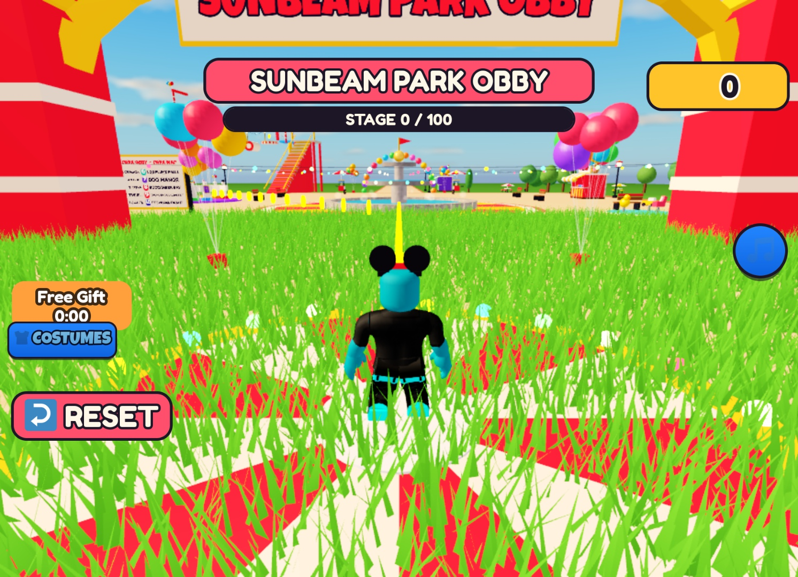
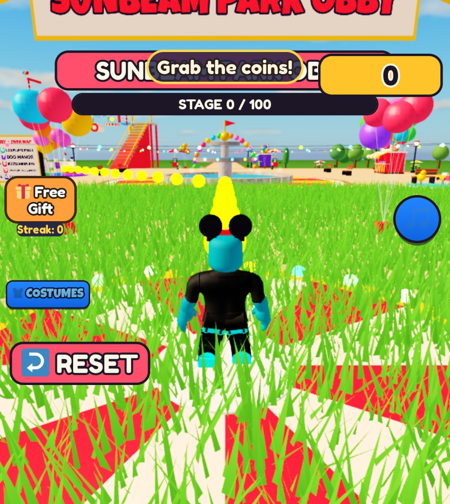

# MuMake

**From an idea to a playable Roblox game in under 20 minutes. Refine it with a few more runs.**

MuMake helps you make, test and optimise Roblox games through either a **native Roblox Studio
plugin** or an **AI assistant plugin connected to Studio through MCP**. Describe what you want
to make, watch the game take shape, try it, and keep improving it through feedback and repeat runs.
All game-production AI goes through [Mubit](https://mubit.ai).

The under-20-minute goal is for a small playable prototype on an already configured setup. Extra
runs focus on bugs, gameplay, balance and polish. Larger games need more time; a playable first
version is the starting point for iteration, not a guarantee that every feature is finished.

**Why we built it.** During the hackathon we made a co-op firefighting game, *Flame and Blame*,
and published it on Roblox as [Firefighter Mubit](https://www.roblox.com/games/130153199199668).
By 25 Oct it had over 250 players, and one of them paid. The game was the proof; MuMake is the
system that makes games like it from one idea, battle-tests them with AI players and learns from
every run.

**MuMake is the product name.** `forge`, `forge-plugin` and `mubit-tester` are the existing tool,
package and integration identifiers you will see in this checkout and its install commands.
They are not the product brand; the commands below use their current names so installation works.

## Two ways to create

| | Native Studio plugin | AI assistant plugin |
|---|---|---|
| Where you work | A MuMake panel inside Roblox Studio | Your connected AI coding assistant, currently packaged for Claude Code |
| How you start | Describe your idea in **Make game** | Ask for a game in plain language |
| How you improve | Build/review rounds, goal checks, feedback and saved revisions | Build, playtest, inspect evidence, add features, fix and verify |
| How much detail | Guided steps or more controls, chosen locally | Conversational help plus direct access to the MCP tools |
| What they share | The existing game builder, tester and Mubit-backed AI tasks | The same game builder, tester and Mubit-backed AI tasks |

The agent workflow has the broader automatic fix/verification and multiplayer toolset. The native
panel keeps creation and testing close to the game. The [native plugin guide](docs/STUDIO_PLUGIN.md)
covers installation and layout settings. The current automatic build/install/review loop is
implemented in [the native builder](mubit-tester/mubit_tester/studio_builder.py).

## A workspace that fits the creator

MuMake is designed for younger creators, adult beginners and experienced Roblox developers.
You should not need to know how to write a test case before you can check your game.

The native plugin offers optional age and experience choices. Age changes the visual treatment;
experience changes the amount of guidance and detail. The current age choices are 13–15, 16–17
and 18+, alongside starting out, made a few things, and confident.

- **Starting out:** examples, clear next steps and a replayable guide, with the real tools available.
- **Some experience:** a compact workspace with useful hints.
- **Experienced:** more direct controls and fewer explanations.

Age never locks a feature. Change the layout, show more controls or go back whenever you want.
The panel also adapts to its dock width. These layout choices stay local, are remembered only if
you opt in, and are not sent to Mubit, attached to game context or collected as analytics. Ideas
and feedback you deliberately submit still follow the normal AI workflow. The assistant plugin
uses its host's chat interface rather than the native panel's layouts.

## Make, play, improve

1. **Describe the game.** For example: “an obby where you collect coins, buy a jump upgrade and
   escape rising lava.” Start with a clear, small player experience.
2. **Build a first version.** The AI plans the systems, reuses available modules, generates the
   scripts and level data, checks compilation and repairs errors.
3. **Try it in Studio.** The native creation flow installs into the connected local place and
   runs build/review rounds. The agent workflow can run Studio playtests and inspect their results.
4. **Check what players can do.** Use saved checks or ask the AI player to attempt a goal, such as
   buying an upgrade. It can manipulate the character and interact with the game, with coverage
   depending on the game's instrumentation and available tools. Report what was actually checked.
5. **Run it again with feedback.** Fix blockers first, then improve mechanics, pacing, content and
   presentation. The agent repair workflow replays changes and keeps verified fixes or rolls them back.

The native loop aims to hand over a game for review around the 20-minute mark. It stops earlier
when its current review standard is met, and can report **Ready for review** while issues remain.
This is a soft handoff target: an in-flight build, model request or test can take longer. Its
current standard uses a playtest, no game errors and a critic score of at least 7/10. This is
separate from the broader `done` evidence bar and the requirements of a published game.

More runs are useful when they improve something the player will notice: a broken shop, an
unreachable level, confusing goals, repetitive content or an unfair progression curve. The shared
[game production guide](docs/GAME_PRODUCTION_GUIDE.md) defines priorities for 16 game families,
architecture foundations, feature/level contracts, testing and model evaluation.

## A team of agents that battle-tests the game

Code that compiles is not a game that works. MuMake does not trust the code; it plays the game.
Each job below is its own AI role with a fixed prompt (in [`forge/prompts/`](forge/prompts/), and
the AI players in [`mubit-tester`](mubit-tester/mubit_tester/ai.py)), and each role is its own Mubit task.

| Stage | Roles | What they do |
|---|---|---|
| Build | director, designer, coder, level designer | Expand the idea into systems, a module plan, Luau files and level data |
| Battle-test | scenarist, AI players, critic, fun critic | Write checks for every mechanic, play the game in Studio like real players, judge whether it works and is fun |
| Find the cause | anomaly detector, auditor, reproducer, investigator | Spot what looks wrong across rounds, prove it with a failing check, then run experiments inside the live game to find the root cause |
| Fix | fixer, patcher, planner, architect | Change the code, add features, consolidate duplicate systems |
| Decide and learn | verifier, check reviewer, reflector | Replay and compare before and after, keep the fix or roll it back, write lessons that go into every future build |

A fix only stays when the replay proves it. If anything got worse, the game version is rolled back.
The lessons file feeds every designer, coder and fixer call, so the next game starts from what the
last one learned.

## Development comparison: the same 100-stage obby

Use [Sunbeam Park Obby](games/sunbeam-park-obby/README.md) as the example: a playable amusement-park
obby with **100 stages across 10 zones**, checkpoints and respawns, coins, a costume shop, music,
a HUD and a decorated park. MuMake made it from **“i want a 100 stage obby”**.

**The manual and plain-MCP times below are illustrative estimates for making a similar first
playable version, not measured benchmarks.** They assume someone familiar with Studio, a configured
workspace and access to reusable assets/components. They exclude learning Studio, making original
art and preparing a full release. MuMake's reusable kits and harness already exist; their original
development time is not included in its per-game build time.

| | Vanilla development | Plain MCP-driven development | MuMake-driven development |
|---|---|---|---|
| First playable obby | **8–20 working hours estimated** | **1–4 hours estimated** | **Under 20 minutes reported**; this demo's build was about **6 minutes** |
| Building | Manually lay out the course, connect systems and build the UI | An AI agent creates and edits through Studio tools; its workflow and integration depend on the session | Parallel level generation, reusable game systems and automatic installation into Studio |
| Testing | Play through, inspect errors and organise checks yourself | The agent can move characters, inspect state and run tests when its workflow calls for them | QA bots, scripted journeys, checks and recorded outcomes are integrated into the workflow |
| Initial refinement | Further manual debugging, balancing and polish; time varies | Further agent runs and review; time varies | **Allow another 10–15 minutes**, an estimated budget for extra testing, fixes and polish |
| Adding a feature later | Plan the change, integrate it and retest | Give the agent context, then review integration and tests | Reuse the game spec, existing systems and saved lessons; check the new behaviour and its impact on the game |
| Learning from previous work | Your experience and notes | Whatever context or memory the agent retains | Lessons and rejected attempts carry forward; corrections go back through the same Mubit tasks |

For MuMake, budget **under 20 minutes to get playing, then another 10–15 minutes to refine**.
Further features can also be quicker to add because the next run can reuse systems, apply saved
lessons and avoid previously rejected approaches. This is an expected workflow benefit rather
than a measured feature-addition speedup.

Plain MCP already supports building and playtesting. MuMake packages the production workflow,
reusable systems, game context and learning records around those tools, so creators do not have
to assemble that workflow themselves.

### What the Sunbeam run actually showed

The [demo reflection](docs/research/2026-10-25-mumake-reflection.md) reports about **six minutes to
the playable build**, with level design running in parallel. MuMake installed it into the existing
Studio window, then ran playtest, critic and fixer rounds, with six QA bots and a scripted Studio
journey. The journey exercised a ride gate, the next zone entrance and the stage-100 finish trigger;
this was not proof of a complete player traversal of all 100 stages.

Four completed rounds reported 0 game errors but stayed at 6/10. Acceptance counters not exercised
fell from nine to five, then stopped moving: costume buying/equipping, gift readiness/claiming and
achievements remained unexercised by those playtests. The run was stopped during round five, and
its dashboard “Ready for review” status was set manually. Later shop-journey fixes do not change
that historical result. The extra **10–15 minutes** above is a refinement budget, not a measured
time to clear every outstanding check or perfect the game.

| After round 1 | After round 4 |
|---|---|
|  |  |

## Why Mubit is part of the loop

MuMake sends game-production AI requests through Mubit: planning, coding, level design, AI players,
critics, auditors, fixers and verifiers. It does not fall back to a direct provider when the Mubit
route fails. Compilers, scripted checks and Studio controls run as ordinary deterministic tools.

Each AI role uses stable instructions so repeated work can be grouped into a recurring task.
Verified mistakes and creator feedback can be sent back as corrections for the relevant task.
Lessons also preserve useful context for future builds. The aim is fewer repeated mistakes and
less time spent retrying the same work as the system gains useful experience.

A recorded correction is not an instant model update. Training depends on accepted examples and
workspace settings; a trained adapter needs evaluation and a verified serving path before claiming
it improves the live workflow. See [Mubit's adapter guide](https://docs.mubit.ai/guides/first-adapter)
and our [production guide](docs/GAME_PRODUCTION_GUIDE.md#12-model-learning-and-evaluation).
These build timings do not isolate a speed benefit from Mubit learning; that needs a controlled
comparison.

### What Mubit has learned so far (25 Oct 2026)

Mubit captured 2,691 investigator calls across 12 sessions. Its reviewer rated 170 of them good
and 230 bad, and those ratings trained **Investigator for Roblox game v2**: a LoRA adapter on
Qwen3-4B-Instruct-2507, served on Mubit Cloud and promoted to **partial rollout** at 05:55 UTC.

| Investigator, Mubit's held-out exam (24 cases) | Score |
|---|---|
| Untrained base (4B) | 33.3% |
| Our adapter (4B) | **75.0%** (95% range 55.1–88.0%) |
| Frontier model | 100% |

On 16 real investigator steps from our games, the adapter returned valid action JSON 16 of 16
times and chose the same action as Claude Sonnet 5.5 16 of 16 times (same action and same file
7 of 16). Its median response was 1.14 s against Claude's 1.78 s.

Seven adapters are trained in total; the investigator is the only one serving. The others are
still below Mubit's readiness bar: automated playtester v2 matches 65% (needs 70%), patcher 50%,
fix verifier, AI game tester and playtest judge 25%, step judge 0%. Training was frozen until
04:18 on 25 Oct because retraining waited for 2,500 new examples; lowering that threshold to 25
produced the v2 adapters within 20 minutes. The adapters learned from one night of calls, and
every game MuMake tests adds more rated calls to the same tasks.

The host chat model is configured separately: installing an MCP plugin does not reroute the
assistant's own inference. Use the Mubit-backed tools for game-production tasks; if the host's
inference is also in scope, configure its Mubit connection separately.

## Install the native Studio plugin

The current distribution is a local plugin installed from this checkout, with a Python 3.11+
companion. Keep the checkout and its environment available while using it.

```bash
git clone https://github.com/chocoliticekreem/mubithack.git
cd mubithack
uv venv
uv pip install -e ".[dev]"
cp .env.example .env
brew install luau
```

Set `MUBIT_API_KEY` in `.env` and choose a model your Mubit workspace can serve. Open your intended
local place in Studio, then enable **Assistant → ⋯ → Manage MCP Servers → Enable Studio as MCP server**.
From the checkout:

```bash
.venv/bin/python scripts/install-studio-plugin.py --load-existing
```

The installer loads MuMake into an already open Studio window and writes
`~/Documents/Roblox/Plugins/MuMake.lua`. It never opens or restarts Studio. If several windows are
connected, select one with `--studio-id <exact-id>`. Open **Plugins → MuMake** and start with
**Make game**. Allow the plugin's local connection when Studio asks.

These dependency commands are for macOS; use your platform's Luau installation method and plugin
directory elsewhere. See [native setup, layout privacy and troubleshooting](docs/STUDIO_PLUGIN.md)
for companion details. Use an unpublished local place: installing a game does not publish it.

## Install the AI assistant plugin

The current Claude Code marketplace identifiers still use `forge` and `mubit-tester`:

```text
/plugin marketplace add chocoliticekreem/mubithack
/plugin install forge@mubithack
/plugin install mubit-tester@mubithack
```

Start a new session and ask:

> Set up MuMake using the installed forge and mubit-tester tools. Connect to my existing Studio
> window, then make a small lava obby with checkpoints and a coin shop. Playtest the core loop,
> fix the important problems and show me what passed and what still needs work.

Setup checks the Mubit connection, available model, Luau compiler and Studio connection. Choose
the intended Studio explicitly; do not open another instance when one is already in use.

| Task | Current MCP tools |
|---|---|
| Check setup | `setup`, `doctor` |
| Build and extend | `build_game`, `iterate`, `correct`, `feature` |
| Improve and assess readiness | `improve_game`, `done`, `tester_report`, `tester_reports` |
| Play and inspect | The `mubit-tester` plugin's scenarios, AI players, judge and `test_feature` |
| Keep or restore versions | `versions`, `rollback` |
| Follow work | `job`, `jobs`, `cancel_job`, `dashboard` |

Long operations run as background jobs. Follow `job(id, wait_seconds=300)` until completion and
read the actual evidence before calling a game ready. Avoid concurrent jobs changing the same
game or Studio session.

## Developer tools and documentation

The CLI remains available under its current `forge` identifier:

```bash
.venv/bin/forge doctor
.venv/bin/forge new "a short lava obby with checkpoints" --iterations 2
.venv/bin/forge fix <slug> --cycles 3 --reports
.venv/bin/forge done <slug> --json
.venv/bin/forge versions <slug>
.venv/bin/forge dashboard --open
.venv/bin/python -m pytest -q
```

Commands that build, review or improve games make paid Mubit calls. Set `FORGE_STUDIO` to the
intended Studio ID before building; commands that expose `--studio` can also select it explicitly.
Keep role prompts frozen; put changing game context and guidance in the user message.

| Resource | What it covers |
|---|---|
| [Game production guide](docs/GAME_PRODUCTION_GUIDE.md) | Genre priorities, architecture, levels, features, tests, improvement and evaluation |
| [Native Studio plugin](docs/STUDIO_PLUGIN.md) | Installation, adaptive UI, local preferences and testing controls |
| [Tester guide](docs/TESTER.md) | Harness, scenarios, character controls and AI testing |
| [Architecture](docs/ARCHITECTURE.md) | Tool and runtime contracts |
| [Benchmarks](docs/BENCH.md) | Reproducible timing and quality measurements |
| [Mubit loop](docs/MUBIT_LOOP.md) | Learning-loop design and integration history |
| [Team workflow](docs/TEAM.md) | Branches, ownership and shared-place workflow |

Source layout: `studio-plugin/` contains the native UI; `forge/` contains the existing Python
build/improve tools; `forge-plugin/` exposes the assistant integration; `mubit-tester/` contains
the tester and native companion. Generated games, evidence and call logs live under ignored
`runs/`. `game/` contains the Flame and Blame demo game and shared runtime helpers.

## Hall of fame!!!

**Christopher White** was here!!!

**Min** was here!!

> Why is the game called *Flame and Blame*? Because that's every codebase: something's on fire, and
> `git blame` says it was you!!!
