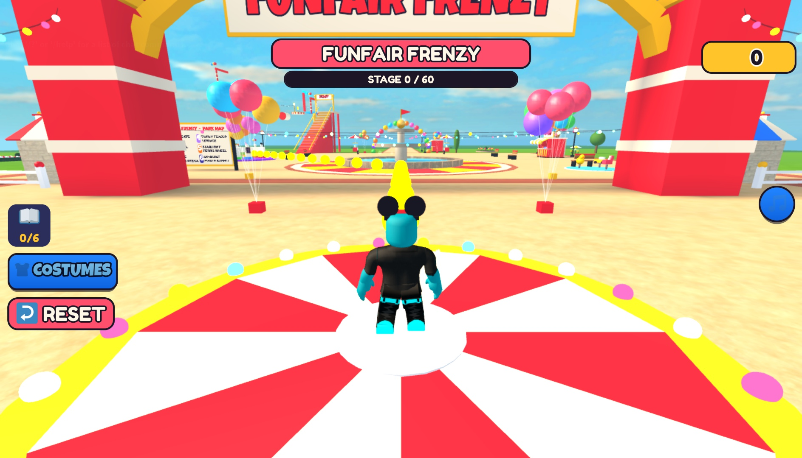
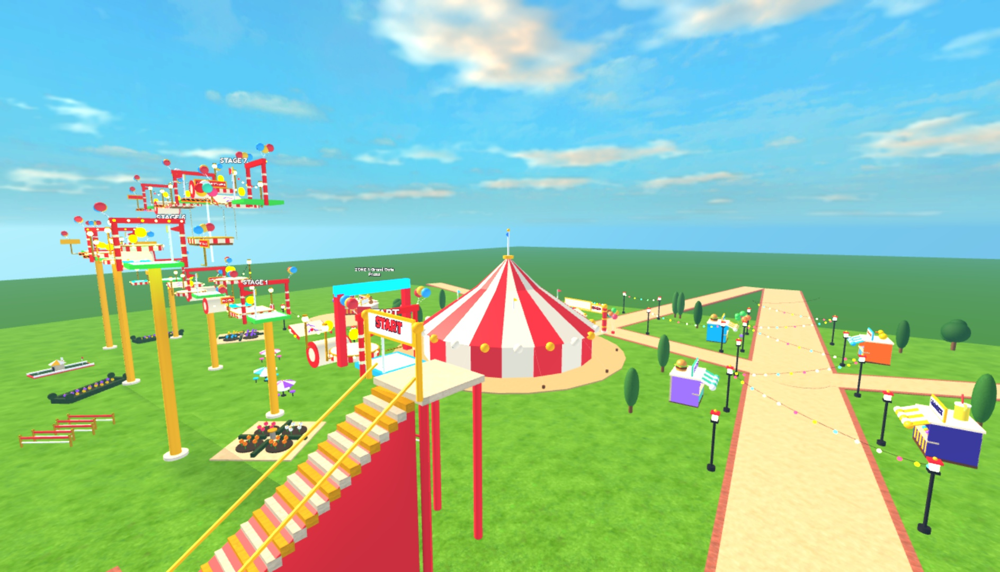
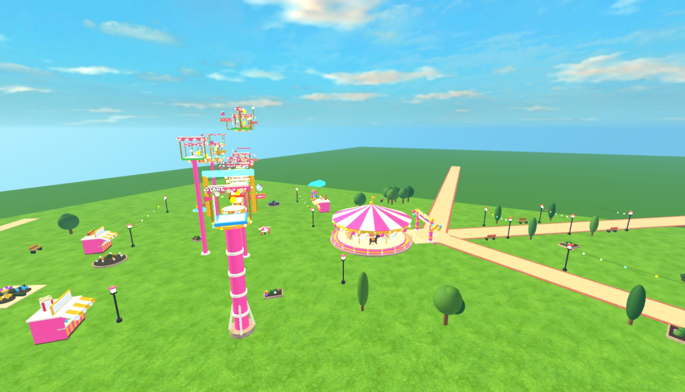

# Overnight: Funfair Frenzy, a 200-stage amusement park obby built by the Mubit system

## Afternoon (24 Oct, 10:20-15:20): the backbone was rebuilt, then the obby was rebuilt from the idea alone

Anson's framing: "we are building a system and you are engineering the backbone that creates the game". The
overnight failure was in the backbone, so the backbone was rebuilt. The model and the prompts were not touched.

**What changed (PR #158, merged as cb5ea39; CI green on main):**
- **WorldKit:** a whole amusement park built from parts and Terrain:
  - an entrance gate arch and a forecourt spawn;
  - a lobby with a fountain, a park map and the START stairs;
  - one animated ride per zone;
  - stalls, lamps with string lights, trees, a fence and hills, dressed along each real course.
- **ObbyKit v2:** each zone is a compact switchback block next to its ride. Forge owns the turns, and the level designer
  fills them in. Ride gates link the zones, new players start in the lobby, and there is one coin ledger.
- **ObbyThemes:** dresses every piece as part of its ride. Walking surfaces stay clear, and kill floors are always
  red-orange.
- **ParkObby (a template kit):** all of a park obby's wiring, tested once:
  - park, course and costumes;
  - a changing room that spends the course's coins, and a lobby coin trail that leads to it;
  - a RESET button, music per zone and the HUD.
  Forge renders the game's Config and bootstraps from the level plan, so no LLM writes plumbing. The director and
  designer may add at most 2 extra modules and may only name counters the kits fire.
- **Interaction audit + player journey:** hard gates in `forge done`, the fix loop and autopilot. Every prompt must have
  a visible effect, every button must be on top and do something, the costume must be worn, and the ride gate is
  ridden.

**The rebuild** (`forge new "Funfair Frenzy: an amusement-park obby. Six themed zones of 10 stages each..." -n 0`):
- 12 Mubit calls in 826 s. The coder wrote 2 modules: timed gifts and a stamp book. Overnight it wrote 37.
- Six zones with six different rides: Grand Gate Plaza (big top), Carousel Corner, Sparkle Bumper Arena, Twirly Teacup
  Terrace, Starlight Ferris Wheel, Skyburst Finale Summit.
- The level designer needed one correction each for zones 3 and 5 (in the same Mubit task). Every zone ended with 0
  jump errors and 0 zone-rule errors.
- Studio playtest:
  - 0 errors;
  - 60 stages, 60 checkpoints, 5 ride gates and 7 landmarks built; no template baseplate;
  - the 18-coin lobby trail paid into the ledger;
  - the Party Cone bought for 10 and was worn;
  - coins collected after the purchase were added on top of it without refunding it.
- Not verified live: a full 60-stage playthrough, the per-zone music switch, and the RESET effect.
- Anson published it ("Amusement Park Obby EASYYYYY!!!", place 90244019666306) and said "it looks really good".

**The self-improvement loop (PR #162, open):** round 1 had kept nothing and then told the detector its findings were
wrong. Now:
- only deterministic signals roll a round back;
- a failed batch blames each job alone;
- a finding becomes a fix job only after the reproducer proves it;
- the detector is labelled by reproduction, and the fixer by the gate.

## Verdict from real play (Anson, 10:15): not good. The run was aborted.
- **"The game uses the same stage 200 times."** True in effect: every stage is a straight line of square slabs floating in the sky (770 of 1,588 pieces are plain platforms, mostly 8×8, 6×6 or 10×10), and there is **no scenery at all**. The amusement park exists only as zone names, colours and music.
- **"The change costume interaction isn't working."** True: `ServerScriptService/Shop.luau` creates the changing room's "Try on costumes" ProximityPrompt but never connects `Triggered`. The panel only opens from the HUD button.
- **Against Flame and Blame:** F&B has 177 files and 74,156 code lines, including **15,166 lines of world building** in `Lib/Map` and 31 services. Funfair has 28 files and 7,561 lines (plus a 3,090-line kit) and **0 lines of scenery**.
- **Why the night's numbers looked good:** the 13/13 checks proved stages *exist* and are *reachable*; `forge compare` (8.5) scores code patterns; neither measures world, variety or interactions. Features were "0/8 verified" because UI presses never ran (locked screen), and that was reported as a side note instead of a blocker.
- **What the system needs next:**
  1. A world: themed scenery and landmarks, and stages that turn, climb and vary.
  2. Checks for what a player feels: every prompt pressed and its effect asserted, plus a variety metric.
  3. Unverified features treated as not done.
- The timeline below is accurate as a record of what ran. Its quality claims are superseded by this verdict.

The goal, from Anson at about 05:45 on 24 Oct, before going to sleep:
- a new obby, amusement park themed, with 200 levels, music, and costumes in the lobby;
- built and run by the Forge + Mubit system;
- every cycle: verify, fix the system, give the agents skills and libraries, make them more efficient, add roles, cut redundant calls, cache, and log everything for reflection;
- keep going until the game is genuinely good, compared against Flame and Blame's code as the ground truth;
- publish it on Anson's account and document everything.

## Plan
1. **Baseline:** build the obby from scratch with the system as it was at 05:00 (director, art kit, UI kit, cache). This is the "before" for comparison.
2. **System upgrades, built in parallel and merged as PRs:**
   - **Obby arsenal:** kit-module mechanism, ObbyKit (checkpoints, obstacles, a LevelBuilder that builds stages from data), a reachability validator, a `level_designer` Mubit role (one call per zone, with validator corrections in the same task), `forge levels`, an obby gap checklist and obby checks.
   - **Music and costumes:** verified music library (every id loaded in Studio), a MusicPlayer kit module (per-zone tracks, crossfade, mute), a Cosmetics kit (part-built costumes, a changing room, saved ownership).
   - **Efficiency and reflection:** measure the waste in real traces, cut the biggest redundant-call patterns, wider safe caching, `forge reflect` after every run.
   - **Harness:** scripted presses of assigned UI, checks must prove their own setup, round restarts, obby tester abilities (`teleport_stage`, `obby_try`).
   - **Ground truth:** `forge compare` scores a game's code against Flame and Blame by category, with pointers to the reference file that does it well.
3. **Cycles:** levels, then music and costumes, then the orchestrator (gap finder, jobs, checks, fix), then verify (`forge done`, `forge compare`, critic, screenshots), then reflect and fix the system. Repeat until good.
4. **Publish** to Anson's Roblox account from Studio, and send the link.
5. **Summary** for the morning: what was built, before and after, the system changes, and what the Mubit traces show.

## Timeline
Times are BST, taken from log files and PR merge times.
- 05:45: goal set. Fresh Studio place `place/park-obby.rbxlx` (studio b0be20cb). Baseline `forge new` started (log `runs/obby-baseline.log`).
- 05:50: five system-upgrade agents launched in parallel worktrees (obby arsenal, music and costumes, efficiency and reflection, harness, compare).
- 05:49–06:02: **baseline result.**
  - The director took 255 s over 3 calls.
  - The coder wrote 11 modules, 8 in parallel. `LevelBuilder.luau` **failed**: the reply was cut off at the 20,000-token output limit.
  - Iteration 1 scored **2/10**: the server blocks forever waiting for the missing LevelBuilder.
  - Iteration 2 scored **3/10**: the lobby, HUD and auto-equipped mouse ears work, but there are no stages.
  - *Reflection:* a 200-stage obby can't be one-shot as code. Levels must be data built by a prebuilt kit; that is what the obby arsenal agent is building.
- 06:30: **#136 merged (efficiency + reflection).**
  - Measured over 2,047 real calls: 42% of investigator calls were JSON repairs (tool-call shaped replies). They now parse locally.
  - Found a real bug: the file index dropped 91 of 175 files in big games, including every Services module. It is now complete and ranked.
  - Investigator step history is capped.
  - Replay of the recorded traces: per fix cycle **42 → 27 calls, 440k → 185k input tokens**.
  - `forge reflect` now runs after every new, fix and orchestrate round.
- 06:38: **#137 merged (`forge compare`).**
  - Flame and Blame vs itself scores 10.0. The agent tycoons score 5.2 and 5.3.
  - The baseline obby compares at **7.5/10** while it plays at **3/10**. Static code comparison can't see that the level builder is missing (juice 10, content 8.5 come from code words).
  - *Reflection:* "genuinely good" needs every signal at once: critic ≥ 8, fun ≥ 8, `forge done` checks green (200 stages exist and are reachable), and compare ≥ 8. That is the bar for the night.
- 06:51: **#138 merged (music and costumes kit).**
  - 16 music tracks from Roblox's licensed APM library, each verified loading in Studio: carnival, lobby, spooky, pirate, coaster, victory and calm-water moods.
  - MusicPlayer: per-area crossfade and mute. Cosmetics: 17 part-built costumes and a changing room, with server-validated buy and equip, welding, and rebuild on respawn.
  - *Finding:* Studio windows on another macOS desktop (Space) don't render, so screenshots time out and tweens freeze there. The fades now step on Heartbeat. The final build and publish use the visible park-obby window.
- ~07:20: **the display had gone to sleep**, which stops Studio rendering, so screenshots and the GUI publish would fail. It is kept awake with `caffeinate -d -i -t 36000`.
- 07:25: **#140 merged (obby arsenal).**
  - Kit modules by genre or keyword; ObbyKit (checkpoints, saved stage, kill parts, fall recovery, coins, 10 obstacle kinds, a LevelBuilder that builds from data).
  - A reachability validator calibrated with a real R15 runner; the `level_designer` Mubit role (one call per zone, validator corrections in the same task); `forge levels`; 9 prebuilt obby checks.
  - Demo: 20 stages from 2 calls, 9/9 obby checks pass.
  - *Merge fix:* music and costumes were set to install for every obby and tycoon. They now install only when the idea mentions music or costumes.
- 07:29: **#142 merged (harness).**
  - A scripted UI pass before free play; checks must prove their own setup; rounds restart after Results.
  - Obby testers: `teleport_stage`, `obby_try` and `observe.obby`.
  - It proved run 2's "unproven" battle pass auto-claim is a real bug.
- 07:29: **cycle 1 started on the upgraded system:** `forge new` (build only), then `forge levels` (10 zones × 20), sync, `forge run -n 2`, obby checks, `forge done`, `forge compare`. Log: `runs/obby-cycle1.log`.
- 08:03: **cycle 1 result** (slug `funfair-frenzy-an-amusement-park-obby-2`).
  - **Build:** the director took 137 s over 2 calls; the coder wrote 10 small modules on top of the kit (largest 399 lines); all 4 kit modules were installed and the 9 obby checks seeded.
  - **Levels:** `forge levels` built 10 zones × 20 stages from **10 Mubit calls with 0 validator errors**: Grand Entrance, Candy Carousel, Bumper Car Circuit, Teacup Twirl, Ferris Wheel Heights, Log Flume Lagoon, Ghost Train Gulch, Roller Coaster Ridge, Midway Arcade Mile, Grand Finale Fireworks.
  - **Checks: 9/9 obby checks pass.**
    - 200 stages built with one checkpoint each, and 0 reachability problems.
    - Saving works and you respawn on your checkpoint; falling puts you back.
    - 156 kill parts kill; moving platforms carry the player.
    - 1,795 coins can be collected.
    - The jump physics match the validator.
  - **Scores:** critic 6, then 4 (the auto-rollback restored v1 as v3); fun 5.2 (juice 4, clarity 5, visuals 7); compare **8.4** (baseline 7.5); first 60 seconds 2/7 beats.
  - *System gaps found:*
    1. The scoring playtest never plays the game: the player stands idle, so the critic scores blind. That is noise, and the rollback may have thrown away a real fix. A **smoke play** agent is now building a no-LLM core-loop play before scoring.
    2. `forge done` shows the rolled-back iteration's critic score (4), not the restored version's (6).
    3. Screenshots time out.
- ~08:05: **the Mac's screen is locked** (`CGSSessionScreenIsLocked = Yes`). The display slept before caffeinate was started.
  - Game logic, checks and harness bots still work through Studio MCP, but nothing renders: no screenshots, and real clicks can't land.
  - **Publishing needs the GUI**, and Studio MCP has no publish tool, so it waits for Anson to unlock. Everything else is prepared so it takes one click.
- ~08:06: **gap finder corrected** (a Mubit correction in the `gap_finder` task).
  - List #1 had three wrong gaps: "course places zero coins" (there are 1,795 and the coin check passed), a sound id that is already blocklisted, and "core loop never exercised" (a harness gap, not a game bug).
  - All three were rejected with the evidence. List #2 is player-facing: onboarding, juice, first purchase, death/zone feedback, HUD, per-zone music, timer, skip stage.
- 08:07: **cycle 2 (features from the gap list) started**, one feature at a time, with the obby checks as the gate and a rollback on any regression.
  - Feature 1 (onboarding: 2 new modules, Onboarding and OnboardingGuide, plus edits to the HUD and lobby) built in 86 s.
  - *My own mistake, caught:* `forge checks --run` does not sync the game into Studio, so my gate checked the old code. I stopped the run (feature 2 had written nothing) and fixed the gate to sync first. Resumed at feature 2; the first synced suite re-verifies feature 1.
- 08:16: **#143 merged:** `forge checks --run` now syncs the game first (a failed sync stops the run; `--no-sync` opts out), so nobody tests stale code again.
- 08:30: **cycle 2 done: all 8 gap-finder features kept.** Each was built by the Mubit agents (planner → coder/patcher → compile → version) and verified against synced code with 9/9 obby checks. Each took about 90–130 s.
  1. onboarding: a 3-step objective line, a beam to the next goal, a pulsing changing-room pad;
  2. juicy coin and checkpoint pickups;
  3. a reachable first costume purchase with a cue;
  4. death, fall, zone-entry and jump-pad feedback;
  5. HUD polish (coin counter pop, hierarchy);
  6. per-zone music and lighting on the MusicPlayer kit;
  7. a run timer with personal best;
  8. a coin-priced skip stage.
  - *Second gate mistake, caught:* feature 7 was rolled back because one check's first attempt timed out (a Studio call hung for 90 s), although the runner's retry passed and the final result was 9/9. The gate now judges the final result. The timer was rebuilt and kept.
  - **Compare 8.5** (content 10, juice 10, robustness 10; architecture 7.6, data 5.7, UI 7.9).
  - *Code-review concerns for the next cycle:* five overlapping juice/feedback modules from separate features, no Init/Start bootstrap like F&B's `Main.server.luau`, and standalone `*Ack` scripts. One feature per gap leaves the code fragmented, so a consolidation pass is needed.
  - The `*Ack` scripts turned out to be telemetry plumbing, not cheating: each feature wrote its own remote so a client effect could bump a server counter. An agent is building a shared client-telemetry channel and `forge consolidate` (new `architect` role: merge overlapping modules, add an Init/Start bootstrap, gated with rollback).
- 08:32–08:58: **cycle 3a, a reproduce-first bug hunt** on the real game (AI testers with obby abilities and macros; 6 anomalies).
  - **Kept, stage 200 finale (v25):** testers reported "199 → 200 unreachable" and the reproducer proved the finale was 160.7 studs against a 98-stud median. The fix edited `Levels/Zone10.luau` into a beatable finale: jump pad, a slightly easier leap, 3 disappearing tiles with longer on-time, a slower spinner. Reachability held.
  - **Kept, lobby coin trail guidance (v26):** the proof found 0 beams on the 12-coin trail, and beams were added. *Caveat:* checks run on the server and can't see the client-side onboarding beam, which is a blind spot.
  - **Proven, not fixed:** one death bumps `player_died` by 2 (the kit and a game module both count). Two fixes were rejected by the verifier's playtest (regression), so the file was restored. This is an overlap bug for consolidation to fix.
  - **Cleared with evidence:** all 199 stage seams measured fair; coin touch works (+1, plus a 24-coin first-buy head start); "runner falls at stage starts" was the test bot's own miss.
  - The suite is now 11 checks; 10/11 pass, and the one failing is the proven double count.
- 08:56: **#145 merged (smoke play).**
  - The scoring playtest now plays the core loop before the critic scores: pickups, a run from spawn, one bot per sampled stage across all zones, and a kill-part touch.
  - The harness runner jumps over lava and uses the players' jump physics.
  - On the same code: idle playtest critic 6 / fun 4.2, smoke-played **critic 7 / fun 6.0**.
- 09:01: harness runtime files refreshed in the obby run; **scoring with smoke play** started (`forge run -n 2`, then done and compare).
- 09:25: **scored with real play.**
  - Smoke play: 3/3 coins; 9/12, then 5/12 bot runs reached the next checkpoint across the zones; spawn to checkpoint 1 reached; dying on lava respawns at checkpoint 1.
  - **Critic 7, 7** (from 6/4 blind): "The game runs end to end with no script errors. The lobby, the 200-stage course across 10 zones, coins, onboarding, checkpoints, zone entry and kill-brick respawn all show up in the counters."
  - **Fun 6.5, 6.2** (from 5.2); juice 6, clarity 6–7, visuals 7.
  - **First 60 seconds: 6/7 beats** (from 2/7; missing `item_bought`). **Sounds: 34 live, 19 played** (from 1/2). **Compare 8.5.**
  - *Blocked by the locked screen, not by the game:* "features 0/8 verified" and the missing `item_bought` both need real UI clicks, which can't land while nothing renders.
  - *New proven problem:* during the coin check the player's Coins went **18 → 15** after touching a coin, so something spends coins on its own. Bug hunt #2 started on it, together with the death double count.
- 09:10–09:29: **bug hunt #2** (4 proven, 3 kept, 1 left as "unproven" with evidence).
  - **Kept, death double count fixed (v31, `Progress.luau`):** one death now counts once. Cycle 1's two attempts at this were rejected; this one passed the check, the guards and the verifier after those corrections went back into the same Mubit task.
  - **Kept, then reverted by me, kit "movers carry" (v30):** the fixer patched ObbyKit to move riders' character root from the server every frame. It passes in Studio but fights client-owned physics, so live players would stutter, and the same check passed without it in cycle 1. The shipped kit was restored (v34).
  - **Kept, then reverted by me, stage-skip exploit (v32):** a tester teleported to stage 60 and expected Stage to follow; obbies only count the next checkpoint by design. The "fix" let any far-ahead checkpoint set the stage. Rolled back (v33).
  - **The fixer also tried to raise the kit's jump height** (9, then 12) to pass a physics check; the check gate rejected both.
- 09:19: **#147 merged:** `forge fix` never edits prebuilt kit modules or GameAssets. It fixes the game code that uses them, or skips with `kit_protected`.
- 09:27: **#148 merged (client telemetry + `forge consolidate`).** ForgeTelemetry counts from LocalScripts over one validated remote, so features stop writing Ack scripts. The new `architect` Mubit role plans module merges and an Init/Start bootstrap, gated with rollback. Demo on a copy: architecture 7.6 → 9.0.
- 09:34: **#149 merged:** the harness `teleport_stage` sets the player's stage through the kit, as a test fixture, so test teleports stop producing false "progression bugs". This is the root cause of the v32 exploit.
- 09:35–09:39: **cycle 5, consolidation of the real game, kept as v37.**
  - Created services and controllers: `GameService`, `SkipStageService`, `FeedbackService`, `HudController`, `JuiceController`, `FeedbackController`, under an Init/Start bootstrap.
  - **13/13 saved checks pass before and after:** death counted once, finale 104 studs, lobby beams 12, coins, saving, reachability for all 200 stages.
  - **Architecture 7.6 → 9.0.** 243 s wall time.
- 09:40: **scoring #2 stopped on purpose.** A teammate's change made `forge run` playtest in the headless engine by default, which can't judge platforming (1/12 bot runs reached, "lava doesn't kill"). Stopped before the fixer acted on bogus evidence; the game was unchanged. From here, obby measurement uses `FORGE_STUDIO_MODE=always` (real Studio physics).
- 09:40: **cycles 6+ handed to `forge autopilot`** (a teammate's loop: observe → detect (anomaly detector + gap finder) → decide → act → verify with automatic rollback → learn). Budget: 650 calls in total for the game (373 used before), 150 min, 4 rounds of up to 3 jobs, target critic and fun 8. Real Studio.
  - The baseline measurement in real Studio: smoke 5/5 steps, 8/12 bot runs reached, one death counted once, 0 errors. Its screenshot of the **costume panel** is `img/01-costumes-panel.png`.
- 09:42: **the screen was unlocked again**, so screenshots render. **Publish attempt.**
  - `place/funfair-frenzy.rbxlx` was built from the consolidated game (the harness scripts switch themselves off outside Studio, so they are safe in a live build) and opened. File → Publish opened the "Publish Experience" dialog.
  - Typing into the dialog never landed: Qt ignores synthetic key events, and AX reads were blocked.
  - Then the frontmost app turned out to be **Arc**: Anson may be at the Mac. I stopped all GUI automation. *Some synthetic keystrokes ("Funfair Frenzy", ⌘A, "Q") may have reached Arc.* No more clicks or keys while the user may be using the computer.
  - The dialog is left open for Anson to finish in about 30 seconds: name, Data Sharing (I recommend off: it trains Roblox AI on the experience's data), Team Create, Next.
